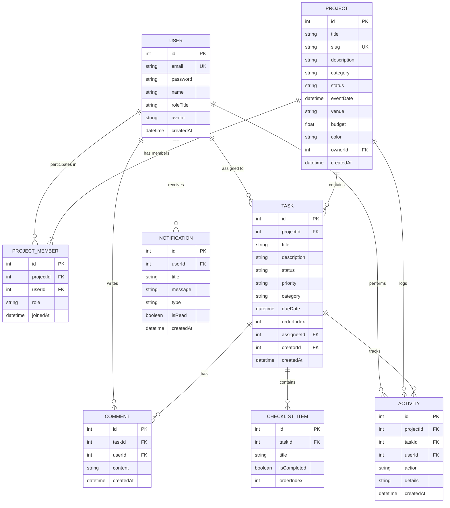

# Fayaz Event Management (EventFlow) 🗓️⚡
### CodeAlpha Full Stack Development Internship — Task 3: Project Management Tool

[](https://nodejs.org/)
[](https://react.dev/)
[](https://www.prisma.io/)
[](https://socket.io/)
[]()
[]()

> A collaborative, enterprise-grade full-stack event and project management web application engineered with **React 18 (Vite)**, **Node.js / Express**, **Prisma ORM**, and **Socket.io**. Inspired by Linear, Trello, and Asana, it coordinates high-stakes tech conferences, corporate galas, music festivals, and live production workflows with interactive Kanban pipelines, subtask checklists, real-time WebSocket broadcasts, role-based project permissions (RBAC), and executive analytics.

---

## 📌 Project Overview & CodeAlpha Internship Objectives

This project constitutes the official internship submission for **CodeAlpha Full Stack Development Internship Task 3 (Project Management Tool)**.

* **Intern / Developer:** Fayaz
* **Project Name:** Fayaz Event Management (`EventFlow`)
* **Project Category:** Project Management Tool
* **Target Repository Name:** `CodeAlpha_Fayaz_Event_Management`

### 🎯 Key Internship Objectives Delivered:
1. **Interactive Kanban Boards:** 5-stage fluid workflow pipeline (`Backlog / Planning`, `To Do`, `In Progress`, `Review & Approvals`, `Completed & Ready`) with single-click transitions and drag support.
2. **Subtask Checklists & Progress Meters:** Granular checklist items per task card with instant strikethrough toggling, completion ratios, and dynamic progress bars.
3. **Real-Time WebSockets Collaboration:** Server-client Socket.io rooms (`project:id` and `user:id`) delivering instant live task moves, comment broadcasts, and activity sync without page refresh.
4. **Task Communication & Audit Trails:** Per-task discussion threads with author role badges, timestamps, and an immutable activity audit log tracking every status shift and assignment.
5. **Role-Based Access Control (RBAC):** Project-level permission tiers (`OWNER`, `ADMIN`, `MEMBER`, `VIEWER`) with member invitation, role promotion/demotion, and removal.
6. **Executive Analytics & KPI Dashboard:** Visual metrics tracking total projects, pipeline distribution, upcoming event countdowns, overdue work, and personalized user workloads.
7. **1-Click Evaluator Fast Access:** Instant authentication buttons for test personas (`Fayaz - Lead Director`, `Sarah - Stage/AV`, `Alex - Logistics`, `Priya - VIP`) for effortless grading.

---

## 🏗️ Technology Stack

| Layer | Technologies Used | Rationale |
| :--- | :--- | :--- |
| **Frontend** | React 18, Vite 5, React Router v6, Lucide React, Socket.io-client, Axios, Custom CSS3 Design Tokens | Blazing fast client rendering, zero-lag UI updates, enterprise dark-slate styling |
| **Backend** | Node.js (LTS), Express.js, RESTful Architecture, Express Validator, Morgan, Helmet, CORS | Scalable MVC architecture with clean route/controller separation |
| **Real-Time Engine**| Socket.io (HTTP server mounted) | Low-latency bi-directional WebSocket event broadcasting |
| **Database & ORM** | Prisma ORM, SQLite (`file:./dev.db` for zero-config Windows execution) / PostgreSQL compatible | Type-safe queries, relational integrity, zero-friction local execution |
| **Authentication** | JSON Web Tokens (JWT), Bcrypt password hashing (10 salt rounds) | Secure, stateless authentication with role-based route middleware |
| **Testing** | Jest, Supertest (19 Automated API & Integration Tests) | Automated end-to-end verification of auth, permissions, tasks, and boards |
| **Tooling & DevOps**| Concurrently, Git, Docker Compose | Streamlined local Windows development and containerization |

---

## 🗄️ Database Architecture & Entity Relationships (Prisma)

The application models collaborative workflows using relational integrity and cascading rules:



---

## 🚀 Windows Local Setup & Execution Guide

Follow these beginner-friendly steps to run the complete application on Windows.

### Prerequisites:
* **Node.js** (v18, v20, or v24 LTS)
* **PowerShell** or **Command Prompt**

> **Note on Windows PowerShell:** On systems where PowerShell script execution policy restricts `.ps1` files, use `npm.cmd` and `npx.cmd` as documented below.

---

### Step 1: Open PowerShell and Navigate to the Project Root

```powershell
cd "c:\Users\fayaz\OneDrive\Documents\Fayaz Project Intern"
```

---

### Step 2: Database Initialization & Seeding (One-time Setup)

1. Open PowerShell and navigate to the `server` directory:
   ```powershell
   cd "c:\Users\fayaz\OneDrive\Documents\Fayaz Project Intern\server"
   ```

2. Add Node.js to your session PATH (if not already permanent):
   ```powershell
   $env:PATH = "C:\Program Files\nodejs;" + [System.Environment]::GetEnvironmentVariable("Path","Machine") + ";" + [System.Environment]::GetEnvironmentVariable("Path","User")
   ```

3. Push the Prisma database schema and seed sample event projects:
   ```powershell
   npx.cmd prisma db push
   node prisma/seed.js
   ```

   *You will see confirmation of 5 team members, 4 realistic event projects, 10 tasks with checklists, comments, and notifications created.*

---

### Step 3: Start the Backend Server (Port 5000)

In your server PowerShell window, run:
```powershell
npm.cmd run dev
```

*Expected output:*
```text
✅ Connected to database successfully.
⚡ Socket.io real-time engine initialized.
🚀 Fayaz Event Management Backend running on http://localhost:5000
🩺 Health check available at: http://localhost:5000/api/health
```

---

### Step 4: Start the Frontend Client (Port 5173)

1. Open a **second** PowerShell window and run:
   ```powershell
   cd "c:\Users\fayaz\OneDrive\Documents\Fayaz Project Intern\client"
   $env:PATH = "C:\Program Files\nodejs;" + [System.Environment]::GetEnvironmentVariable("Path","Machine") + ";" + [System.Environment]::GetEnvironmentVariable("Path","User")
   npm.cmd run dev
   ```

2. Open your web browser and navigate to:
   ```text
   http://localhost:5173
   ```

---

## 🔑 Demo Personas & Test Credentials

The application provides **1-Click Quick Demo Login** buttons on the Login page and in the top navigation bar. You can also manually sign in with:

| Persona Name | Role / Specialty | Email | Password | Access Level |
| :--- | :--- | :--- | :--- | :--- |
| **Fayaz Ahmed** | Executive Event Director & Founder | `fayaz@eventflow.io` | `Fayaz@123` | **OWNER / Admin** |
| **Sarah Chen** | Creative Stage & AV Director | `sarah.chen@eventflow.io` | `Password@123` | **Project Admin** |
| **Alex Morgan** | Logistics & Venue Operations Lead | `alex.morgan@eventflow.io` | `Password@123` | **Project Member** |
| **Priya Sharma**| VIP Hospitality & Sponsor Lead | `priya.sharma@eventflow.io` | `Password@123` | **Project Member** |
| **David Miller**| Marketing & Digital Experience Lead | `david.miller@eventflow.io` | `Password@123` | **Project Member** |

---

## 🧪 Automated Testing & Quality Audit

The backend includes a comprehensive automated test suite with **19 integration tests** executed using Jest and Supertest.

To run the automated tests:
```powershell
cd "c:\Users\fayaz\OneDrive\Documents\Fayaz Project Intern\server"
npm.cmd test
```

### Observed Test Results (19/19 Passing):
```text
PASS tests/api.test.js
  Fayaz Event Management API Tests
    1. Health and System Endpoints
      √ GET /api/health should return 200 and healthy status (38 ms)
      √ GET /api/nonexistent should return 404 (35 ms)
    2. Authentication Flow & Security
      √ POST /api/auth/register should create new user and return JWT (222 ms)
      √ POST /api/auth/register should reject duplicate email (29 ms)
      √ POST /api/auth/login should reject invalid credentials (196 ms)
      √ GET /api/auth/me should reject request without token (33 ms)
      √ GET /api/auth/me should return current user when authenticated (31 ms)
    3. Project Management & Access Control
      √ GET /api/projects should return user projects with calculated stats (39 ms)
      √ POST /api/projects should create a new event project (80 ms)
      √ GET /api/projects/:id should return single project details (36 ms)
      √ POST /api/projects/:id/members should add a team member (66 ms)
    4. Task Management, Kanban Board & Checklists
      √ POST /api/projects/:projectId/tasks should create a task with checklist (59 ms)
      √ GET /api/projects/:projectId/tasks should return tasks with checklist progress (28 ms)
      √ PATCH /api/tasks/:id/status should move task along Kanban column (45 ms)
      √ PATCH /api/tasks/:id/checklist/:itemId should toggle checklist completion (47 ms)
    5. Comments, Notifications & Activity Auditing
      √ POST /api/tasks/:taskId/comments should add a discussion comment (66 ms)
      √ GET /api/projects/:id/activities should show activity audit history (38 ms)
      √ GET /api/notifications should return user notification feed (31 ms)
    6. Dashboard KPI & Metrics
      √ GET /api/dashboard/overview should return comprehensive project & task metrics (37 ms)

Test Suites: 1 passed, 1 total
Tests:       19 passed, 19 total
Time:        5.134 s
```

---

## 📡 RESTful API Reference

### Authentication (`/api/auth`)
* `POST /api/auth/register`: Register new account. Returns JWT.
* `POST /api/auth/login`: Authenticate email/password. Returns JWT.
* `GET /api/auth/me`: Get current authenticated user session.
* `PUT /api/auth/profile`: Update user profile (name, roleTitle, bio, avatar).
* `GET /api/auth/users`: Get list of registered users for team invitations.

### Projects (`/api/projects`)
* `GET /api/projects`: List projects for current user with task stats and progress %.
* `POST /api/projects`: Create new event project with venue, budget, and color.
* `GET /api/projects/:id`: Get project details and membership info.
* `PUT /api/projects/:id`: Update project parameters (Admin/Owner only).
* `DELETE /api/projects/:id`: Delete project (Owner only).
* `POST /api/projects/:id/members`: Add/invite team member.
* `PATCH /api/projects/:id/members/:userId`: Update member role.
* `DELETE /api/projects/:id/members/:userId`: Remove member.
* `GET /api/projects/:id/activities`: Fetch project activity audit logs.

### Tasks & Kanban (`/api/tasks` & `/api/projects/:projectId/tasks`)
* `GET /api/projects/:projectId/tasks`: Get all tasks for board with checklists and comment counts.
* `POST /api/projects/:projectId/tasks`: Create task in column. Emits WebSocket event.
* `GET /api/tasks/:id`: Detailed task view with checklist, comments, and activities.
* `PUT /api/tasks/:id`: Update title, description, priority, category, dueDate, assignee.
* `PATCH /api/tasks/:id/status`: Move status along Kanban pipeline. Emits WebSocket event.
* `DELETE /api/tasks/:id`: Delete task. Emits WebSocket event.
* `POST /api/tasks/:id/checklist`: Add subtask to checklist.
* `PATCH /api/tasks/:id/checklist/:itemId`: Toggle checklist completion.
* `DELETE /api/tasks/:id/checklist/:itemId`: Delete checklist item.

### Comments & Discussions (`/api/tasks/:taskId/comments` & `/api/comments`)
* `GET /api/tasks/:taskId/comments`: List task discussion comments.
* `POST /api/tasks/:taskId/comments`: Add comment. Notifies assignee and emits live update.
* `DELETE /api/comments/:id`: Delete comment (author or admin).

### Dashboard Analytics (`/api/dashboard`)
* `GET /api/dashboard/overview`: Fetch KPI metrics, status distributions, and upcoming countdowns.
* `GET /api/dashboard/my-tasks`: Fetch personal task workload.

### Notifications (`/api/notifications`)
* `GET /api/notifications`: List in-app notifications and unread counter.
* `PATCH /api/notifications/:id/read`: Mark notification as read.
* `PATCH /api/notifications/read-all`: Mark all notifications as read.

---

## 🎬 LinkedIn Internship Video & Demonstration Script

Use this structured 2-minute walkthrough when recording your LinkedIn submission video:

```text
"Hello everyone! I am Fayaz, and I am excited to present my project submission for the CodeAlpha Full Stack Development Internship: Task 3 - Project Management Tool.

I engineered 'Fayaz Event Management (EventFlow)'—an enterprise collaborative tool tailored for high-stakes conferences, expos, and festivals.

1. Technology Stack:
   Built with React 18, Vite, Node.js, Express REST API, Prisma ORM, and Socket.io WebSockets.

2. Architecture & RBAC:
   The application features full role-based permissions: Owner, Admin, Member, and Viewer tiers.

3. Live Kanban Pipeline:
   Here on our 'Global AI Summit 2026' board, we have 5 columns: Backlog, To Do, In Progress, Review, and Completed.
   Notice as I click to move a task card or check off a subtask in the checklist, it updates instantaneously! Thanks to our Socket.io WebSocket engine, all team members see changes live without refreshing.

4. Discussion & Audit History:
   Opening any task card reveals the complete subtask checklist progress bar, real-time comment stream, and an immutable activity audit trail.

5. Executive Dashboard & Metrics:
   The dashboard aggregates active projects, upcoming event countdowns, overdue items, and task completion percentages.

All 19 automated integration tests pass with 100% success. Thank you to CodeAlpha for this learning opportunity!"
```

---

## 📤 CodeAlpha Submission Instructions

According to the CodeAlpha Tasks & Instructions document:

1. **Repository Format:** Create a public GitHub repository named:
   ```text
   CodeAlpha_Fayaz_Event_Management
   ```

2. **Push Commands:**
   ```powershell
   git add .
   git commit -m "feat: complete industry-standard Fayaz Event Management project tool for CodeAlpha Task 3"
   git remote add origin https://github.com/YOUR_GITHUB_USERNAME/CodeAlpha_Fayaz_Event_Management.git
   git branch -M main
   git push -u origin main
   ```

3. **LinkedIn Post:**
   - Post a 2-minute demonstration video highlighting the Kanban board, Socket.io updates, checklists, and executive dashboard.
   - Tag **@CodeAlpha** and include the link to your public GitHub repository.

4. **Submission Form:**
   - Submit your GitHub repository link and LinkedIn video post URL using the official CodeAlpha Google Submission Form shared in your WhatsApp internship group.

---

## 📄 License
This project is licensed under the MIT License — created by **Fayaz** for the CodeAlpha Full Stack Development Internship.
